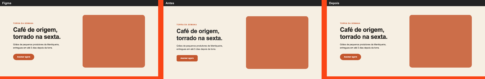

# pixel-perfect · skill de Claude Code

Skill para o Claude Code implementar telas do Figma **com fidelidade e com prova**. Em vez de
"ficou parecido", cada mudança visual passa por camadas de verificação com número no fim:

```
1 tokens → A assets → 2 estilos → 3 pixels → T trade-offs → C custo → 4 olhar
 estático   estático   browser     browser    browser       browser    humano
```



| Camada | O que pega | Script |
|---|---|---|
| **1 · tokens** | hex fora da paleta, "quase igual", fonte/raio fora da escala, hex no lugar do token (CSS e classes Tailwind) | `audit.mjs` |
| **2 · estilos** | estilo **computado** × valor do nó do Figma: tamanho, peso, tracking, cor com alfa, caixa, posição | `pixel.mjs styles` / `regress` |
| **3 · pixels** | diff por seção contra a referência do Figma, com máscaras para dado do CMS | `pixel.mjs shot` / `diff` |
| **4 · olhar** | revisão explícita: abrir o `compare.png` e listar 3 diferenças | `pixel.mjs side` |
| **sem MCP** | quando o MCP não lê o arquivo: costura do protótipo, diff por seção, tipografia nó a nó | `figref.mjs` |
| **A · T · C** | asset pesado/errado, efeito caro sem decisão registrada, orçamento de LCP/bytes | `assets.mjs` / `perf.mjs` |

Nasceu em projetos reais de e-commerce e landing (TanStack Start + Figma) e foi generalizada:
tudo que muda de um projeto para outro fica em `project.md` e `config.json`.

## Instalar num projeto

```bash
git clone https://github.com/PedroJorgeSA/pixel-perfect-skill
cp -r pixel-perfect-skill/skill/pixel-perfect <seu-projeto>/.claude/skills/
cd <seu-projeto> && npm i -D sharp && echo ".pixel/" >> .gitignore
```

Depois, no Claude Code: *"Configure a skill pixel-perfect para este projeto (Figma: &lt;url&gt;)"*.
Ele preenche `project.md` (arquivo e nós do Figma, paleta, tipografia, regra de escala) e
`config.json` (viewports, fonte, de onde vêm os tokens).

Requisitos: Node ≥ 22, Chrome/Chromium (ou `CHROME_PATH`), `sharp`. Sem Puppeteer nem
Playwright: os scripts falam CDP direto com o Chrome headless.

## Ver funcionando (sem Figma, sem projeto)

```bash
npm install
npm run demo                                          # landing com 4 desvios → reprova
bash examples/01-landing-demo/run.sh site-corrigido   # mesma landing corrigida → passa
bash examples/03-landing-sem-mcp/run.sh               # modo sem MCP
npm test                                              # 20 testes da skill
```

```text
── Camada 1 · tokens (audit.mjs)
     3  ERRO  color: #2b2b2b  →  cor fora da paleta do Figma
     6  ERRO  font-size: 54px  →  54px não existe na escala tipográfica do Figma
     8  ERRO  border-radius: 12px  →  raio 12px não existe no Figma (escala: 999/24px)
── Camada 2 · estilos computados (pixel.mjs styles)
FALHA  título · font-size: esperado 56px · obtido 54px
FALHA  CTA · Assinar agora · border-radius: esperado 999px · obtido 12px
11/16 propriedades batem com o Figma
── Camada 3 · diff de pixels
mismatch 5.82% (máx 2%) · reprova · altura: Figma 640px x site 664px (Δ 24px)
```

## Exemplos

| | |
|---|---|
| [`examples/01-landing-demo`](examples/01-landing-demo/) | O protocolo inteiro numa hero, com a versão errada e a corrigida |
| [`examples/02-storefront-tailwind`](examples/02-storefront-tailwind/) | Tokens no `@theme` do Tailwind v4, specs com `requires` (catálogo) e `before` (estado aberto) |
| [`examples/03-landing-sem-mcp`](examples/03-landing-sem-mcp/) | Sem acesso ao Figma pelo MCP: o diff de pixels dá verde e a medição nó a nó acha os 3 bugs |
| [`examples/prompts.md`](examples/prompts.md) | O que pedir ao Claude e o relatório que volta |

## Estrutura

```
skill/pixel-perfect/          ← copie esta pasta para .claude/skills/
  SKILL.md                    regras, armadilhas do Figma MCP, protocolo e formato do relatório
  project.md                  modelo: dados do SEU projeto (Figma, paleta, tipografia, escala)
  config.json                 modelo: o que os scripts leem (ou PIXEL_CONFIG=<arquivo>)
  scripts/                    audit · pixel · figref · assets · perf (+ lib/)
  specs/                      specs da camada 2 que viram regressão
  perf/                       budgets.json (orçamento) e tradeoffs.json (decisões de efeito caro)
  references/                 performance.md (camadas A/T/C) e agent-brief.md (agentes em paralelo)
  tests/                      testes dos scripts (node --test)
examples/                     três projetos de exemplo + prompts
ci/design-gates.yml           modelo de GitHub Actions: static → browser → preview
```

## Princípios

- **O Figma é a fonte da verdade.** A skill reproduz; não "melhora". Divergência estranha no
  Figma é apontada, não corrigida por conta própria.
- **Regra que não dá para checar não é regra.** Cada regra do SKILL.md tem o script que a confere.
- **Medir o computado, não o escrito.** `0.02em` declarado no lugar errado vira o tracking errado;
  peso `500` no container não chega ao glifo se o rich text fixa `400`.
- **Sem MCP = mais verificação, não menos.** Referência de tela não serve para tipografia fina:
  aí vale a medição nó a nó.
- **Custo tem dono.** Blur, blend e vídeo só entram com uma decisão registrada por design + front.

## Licença

MIT
