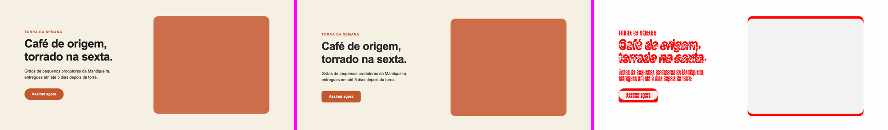

# 01 · Landing demo — o protocolo inteiro em 30 segundos

Uma hero ("Café Aurora") com o frame do Figma em [`figma/`](figma/) e duas implementações:

- [`site/`](site/) — com 4 desvios que aparecem em todo PR de UI:
  1. cor "quase igual" no texto (`#2b2b2b` no lugar de `Ink/900 #1f1d1a`);
  2. fonte arredondada (`54px` no lugar de `56px`);
  3. raio inventado no CTA (`12px` no lugar da pílula `999px`) e hex no lugar do token;
  4. seção 24px mais alta que o frame.
- [`site-corrigido/`](site-corrigido/) — a mesma página fiel ao frame.

```bash
npm install
npm run demo                                          # site/ → reprova
bash examples/01-landing-demo/run.sh site-corrigido   # → passa
```

## O que cada camada pega

```text
── Camada 1 · tokens (audit.mjs)
     3  ERRO  color: #2b2b2b  →  cor fora da paleta do Figma — conferir o nó (use_figma) e registrar em config.json tokens.palette
     6  ERRO  font-size: 54px  →  54px não existe na escala tipográfica do Figma
     8  aviso  background: #c4572e  →  var(--color-terracotta)
     8  ERRO  border-radius: 12px  →  raio 12px não existe no Figma (escala: 999/24px)

── Camada 2 · estilos computados (pixel.mjs styles)
FALHA  hero · caixa · height: esperado 640px · obtido 664px
FALHA  título · font-size: esperado 56px · obtido 54px
FALHA  título · color: esperado rgb(31, 29, 26) · obtido rgb(43, 43, 43)
FALHA  título · letter-spacing: esperado -1.12px · obtido -1.08px
FALHA  CTA · Assinar agora · border-radius: esperado 999px · obtido 12px
11/16 propriedades batem com o Figma

── Camada 3 · diff de pixels (pixel.mjs shot + diff)
mismatch 5.82% (máx 2%) · reprova
· altura diferente: Figma 640px x site 664px (Δ 24px) — comparado só até 640px
```

Repare no `letter-spacing`: ninguém mexeu nele. Ele é `-0.02em`, então errou junto com o
tamanho — é por isso que a camada 2 mede o valor **computado**, não o CSS escrito.

Camada 4 (`compare.png`: Figma | site | diff):



Versão corrigida: `0 erro(s) · 0 aviso(s)`, `16/16 propriedades`, `mismatch 0%`.

## Arquivos

| Arquivo | Papel |
|---|---|
| `config.json` | viewports, fonte, color styles e de onde vêm os tokens (`site/tokens.css`) |
| `specs/hero-desktop.json`, `specs/hero-mobile.json` | camada 2: valores lidos do nó, com o node id |
| `figma/hero-1440.png` | referência da camada 3 (no projeto real: `get_screenshot` do nó) |
| `run.sh` | as 4 camadas em sequência; exit 1 se alguma reprova |

Para virar regressão: `PIXEL_CONFIG=examples/01-landing-demo/config.json node skill/pixel-perfect/scripts/pixel.mjs regress --dir examples/01-landing-demo/specs` (com o servidor do exemplo no ar: `node examples/serve.mjs examples/01-landing-demo 4400`).
